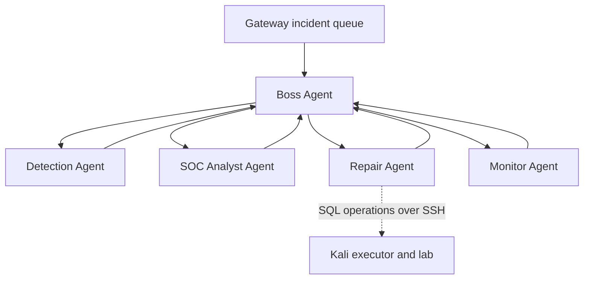

# Team B Sentinel — Five Agents

Windows runs **Boss, Detection, SOC Analyst, Repair, and Monitor** as five real LangGraph nodes. The existing gateway and dashboard from the uploaded project are retained. Kali runs the disposable vulnerable website and an SSH execution component. Start with SQL injection and brute force; HTTP flood classification is disabled by default.

Read **START-HERE.md** for exact Windows/Kali commands.

## What happens automatically

1. The Windows gateway inspects SQL signatures and counts failed login responses. It blocks suspicious requests quickly and queues an incident.
2. Boss dispatches Detection, receives its evidence decision, then dispatches SOC Analyst.
3. SOC Analyst explains the evidence and chooses the scoped action. An optional local Ollama model can add an advisory explanation.
4. Boss dispatches Repair. For SQL, it applies a temporary gateway guard and, when configured, generates a candidate source patch on Windows. Kali tests the candidate, backs up the original, applies it and verifies HTTP behaviour. Failed deployment verification triggers rollback.
5. For brute force, Repair installs an expiring, source-scoped login cooldown in the Windows gateway. This is **mitigation, not a source-code patch**. Other routes and other source IPs remain usable.
6. Monitor verifies health and active policy, then returns to Boss to record the result. Monitor also checks health every 10 seconds between incidents.

## Architecture

All five graph nodes run in the **Windows start.py process**. Kali has no LangGraph dependency. Detection also has a fast request-path check so a queued analysis never needs to finish before an obviously suspicious request is blocked.

## Exact capabilities and limits

- SQL generator: Python `db.execute` calls using simple concatenation, f-strings, `%s` interpolation or positional `{}` `.format()` calls. Simple SQLite SELECT queries with whole quoted string values in `=`, `!=`, `<>`, AND/OR predicates.
- Dynamic identifiers, joins, wildcard construction, conversions, unsupported expressions and ambiguous variable reuse are refused. Existing parameterized calls are left unchanged; this does not certify every skipped query as secure.
- The first onboarded deployment is **kali_lab/unsafe_demo.py**, `/products`, its `search_product` function and its product/login regression contracts. The source generator is more reusable than that adapter. Other websites need source mapping, driver-specific handling and appropriate tests before deployment.
- SQL request signatures are evidence of an **attempt**, not proof of exploitable SQL. Repair independently checks the application behaviour.
- Brute force: five HTTP 401 responses on `/login` from one source in 60 seconds; cooldown 120 seconds by default. This does not detect all password spraying or distributed attacks. It can also temporarily restrict legitimate users sharing an IP.
- Only traffic through Windows port 8080 is protected. Direct requests to the Kali app bypass the gateway. Keep the lab on the private VM network and route demonstrations through Windows.
- The bundled source test copy runs in a subprocess on the disposable Kali VM. It is not a hardened container sandbox. Use only the supplied/trusted lab source.
- Source repair uses reviewed deterministic transformations, not LLM-generated patches. LangGraph supplies the five-agent orchestration. With OLLAMA_MODEL unset no language model runs; with it set, only SOC explanations use the configured local model.
- SQLite incident/rule/audit storage persists across restart. Graph execution itself is not durable/resumable: interrupted incidents are marked, not automatically replayed. Pending source changes have a recovery journal.
- Stop/start is a brief app interruption, not zero-downtime deployment. If SSH fails, inspect the source report before retrying; do not treat a health check as proof of repair.
- A verified SQL source repair remains after the temporary gateway rule expires. Brute-force protection is an expiring policy plus ongoing detection.

## Files to study

| File | Role |
|---|---|
| `sentinel/core.py` | Five-agent graph, Boss routing, evidence, policies, continuous monitor |
| `sentinel/web.py` | Gateway, authenticated management API, service lifecycle |
| `sentinel/sql_patterns.py` | Windows candidate patch generator |
| `sentinel/remote.py` | Pinned SSH transport and source-repair operation sequence |
| `kali_lab/executor.py` | Kali execution state machine; no AI decision graph |
| `kali_lab/worker_support.py` | Tests, backups, owned process restart, rollback |
| `kali_lab/unsafe_demo.py` | Disposable SQL and login learning backend |
| `website/` | Dashboard, live five-agent activity and source reports |
| `tests/` | Gateway, graph, source repair and loopback SSH integration tests |

The updated package excludes uploaded virtual environments, credentials, live databases, old reports, and duplicate test trees. It contains a fresh configuration template; your original upload is not executed during development.
